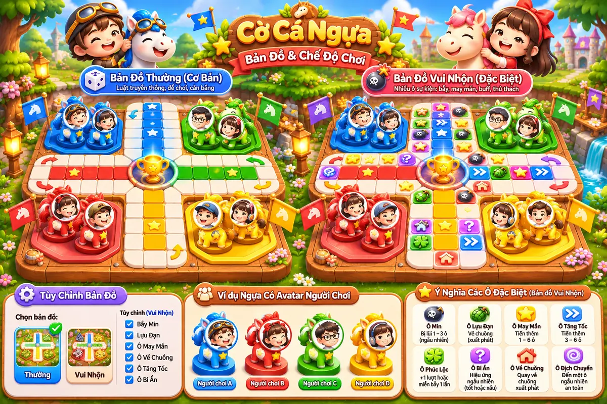

# Mockup đã duyệt — Cờ Cá Ngựa 3D Chibi

> **Trạng thái:** ĐÃ DUYỆT PHONG CÁCH VISUAL (06/11/2026)  
> **Nguồn:** Mockup được tạo và duyệt trong cuộc hội thoại thiết kế dự án.  
> **File chuẩn tham chiếu:** [approved-chibi-3d-avatar.webp](./approved-chibi-3d-avatar.webp)

## Các điểm đã chốt

- **3D chibi dễ thương**, ngựa đầu to, tròn mũm mĩm, mặt biểu cảm; chất liệu mô hình đồ chơi, sáng và mềm.
- Bàn cờ đặt trong **thế giới hoạt hình vui vẻ** (cây xanh, hoa, thác nước, cờ hiệu nhỏ, bàn gỗ).
- **Không theo phong cách casino/cờ bạc:** tránh nền tối, đèn neon gắt, hiệu ứng vàng kim quá nhiều, hình ảnh đặt cược.
- Có **2 bản đồ**: `Cơ bản` và `Vui nhộn`. Cùng một phong cách, khác tính năng của ô.
- **Avatar người chơi hiện trên đầu/mặt quân ngựa**; cả bốn quân của một người dùng cùng avatar, phân biệt bằng bốn màu đỏ, xanh dương, xanh lá, vàng.
- Có 2 skin: `Classic` / `Funny`, không ảnh hưởng trực tiếp luật chơi; hình ảnh mockup ưu tiên ngựa Funny.
- Map vui nhộn có biểu tượng **bẫy mìn, lựu đạn, may mắn, tăng tốc, dịch chuyển, về chuồng, bí ẩn**; các biểu tượng chỉ là gợi ý vị trí/kiểu hình ảnh, **chưa chốt tọa độ hay luật**.

## Lưu ý khi triển khai

1. Đây là **moodboard và visual reference**, chưa phải lưới đường đi chuẩn hoặc ảnh thay thế code bàn cờ.
2. Thiết kế bàn cờ thật phải tuân thủ lộ trình, số lượng ô và luật chơi Cờ Cá Ngựa Việt Nam đã chốt.
3. UI thật phải dễ đọc trên mobile, tách asset horse/avatar/board/tile, có thể thay skin và màu.
4. Avatar được cắt/định vị trong vùng đầu ngựa; không dùng avatar tĩnh nằm tách rời quân cờ.
5. Tối ưu performance: texture atlas / sprite, lazy-load asset, hiệu ứng chuyển động có thể tắt.
6. Mọi chỉnh sửa hình ảnh sau này cần bám phong cách trên, chỉ thay đổi khi được duyệt.

**Trạng thái triển khai:** Chưa viết code game từ mockup này.
